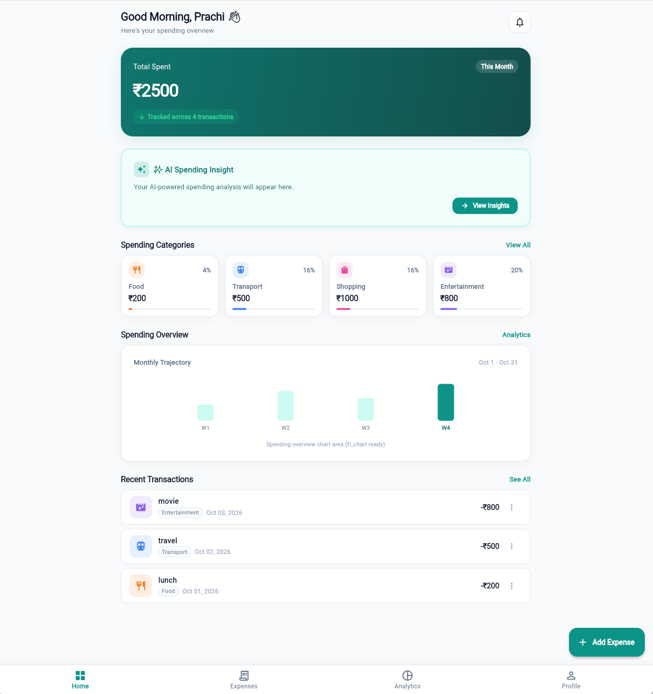
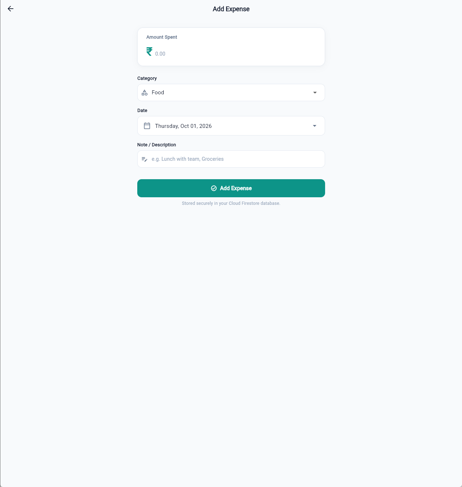
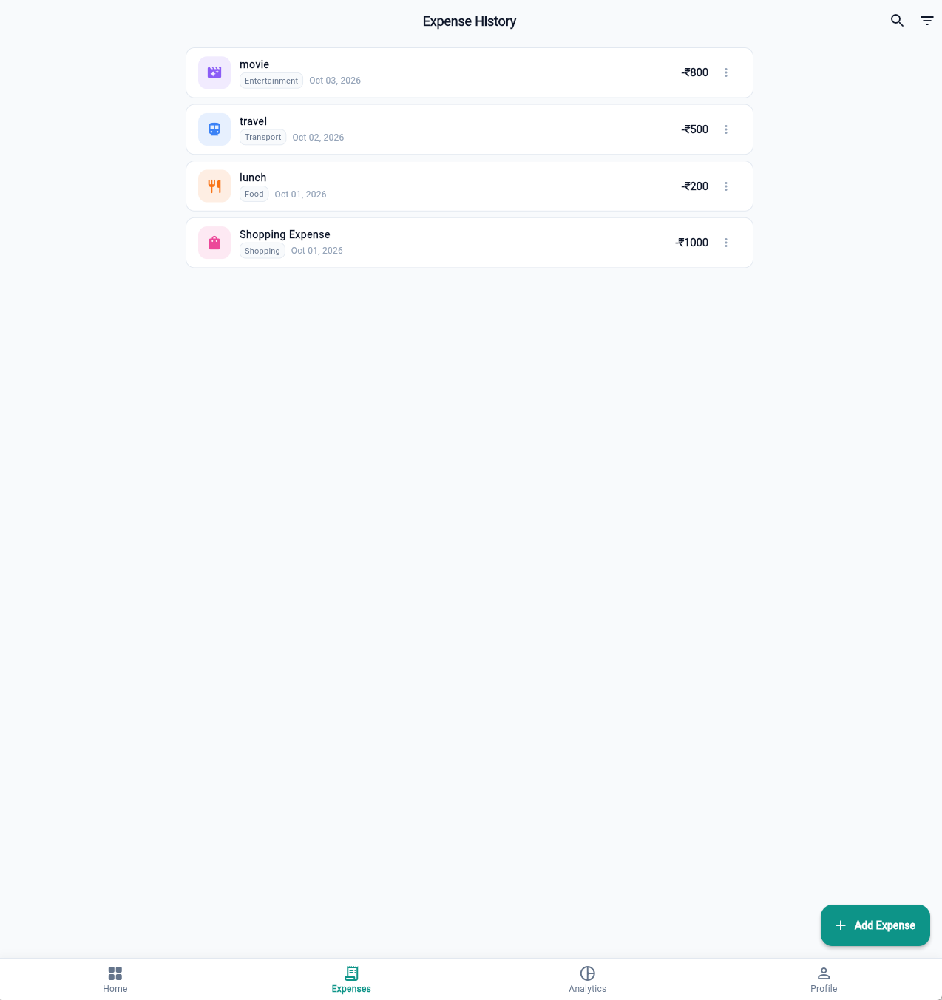
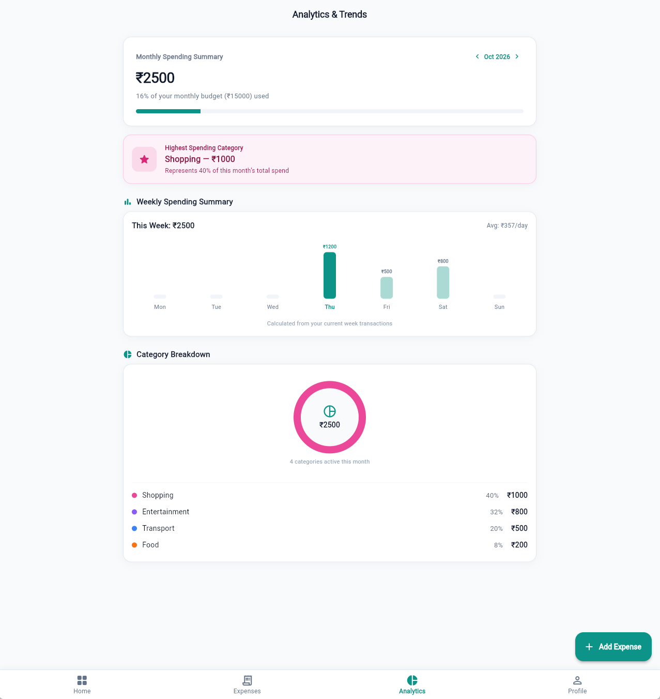
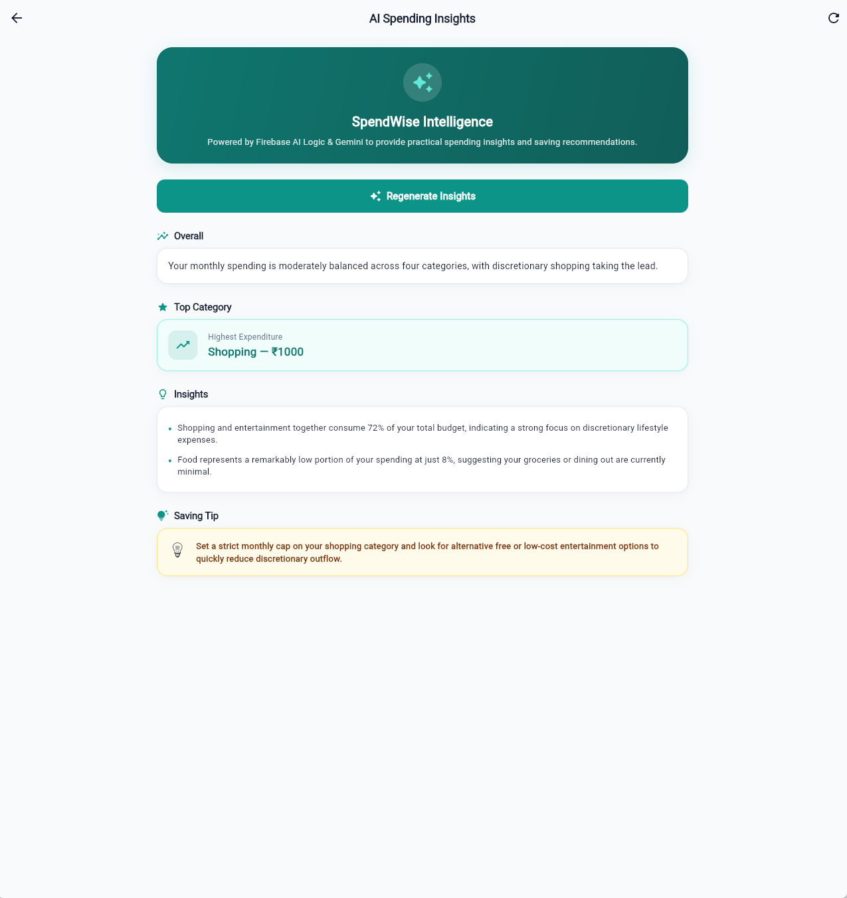
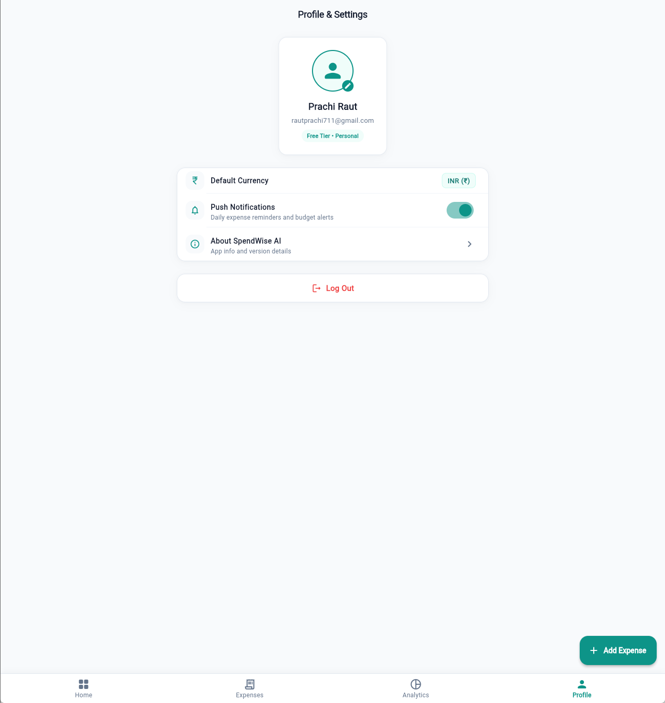

# SpendWise AI 💰

A smart personal expense tracker built with Flutter, Firebase, GetX, and Gemini AI.

## 📱 About the Project

SpendWise AI is a mobile and web application designed to help individuals track and manage their personal expenses effortlessly. The application allows users to log daily expenses with categories, amounts, dates, and notes, giving them clear visibility over where their money goes.

The app features a visual analytics dashboard that summarizes monthly spending, tracks budget usage, displays a weekly spending chart, and breaks down expenses by category.

To help users build better financial habits, SpendWise AI integrates automated AI spending insights and practical saving tips powered by Gemini. All data is securely stored per authenticated user in Cloud Firestore, ensuring that each user only sees their own financial records.

## ✨ Features

* **User Authentication**: Secure user registration and login using email and password.
* **Persistent Session**: Keeps the user logged in across app restarts until they explicitly log out.
* **Add Expense**: Quick entry for recording expense amounts, selecting categories, picking dates, and adding notes.
* **View Expense History**: Browse past expenses in chronological order with category filtering.
* **Edit Expense**: Update existing expense details (amount, category, date, or note).
* **Delete Expense**: Remove an expense entry with a confirmation prompt.
* **Expense Categories**: Categorize expenses into Food, Transport, Shopping, Entertainment, Bills, Health, and more.
* **Home Dashboard**: View total monthly spend, recent transactions, spending categories, and an overview summary card.
* **Monthly Spending Analytics**: View total spending for the selected month, compare with the monthly budget, and navigate across months.
* **Weekly 7-Day Spending Chart**: Dynamic visual bar chart displaying day-by-day spending for the current week.
* **Category-Wise Breakdown**: Visual breakdown showing each category's total amount and percentage of monthly spending.
* **AI-Generated Spending Insights**: Automated financial summary analyzing top expenditure and spending patterns.
* **AI-Generated Saving Tip**: Practical, contextual advice to reduce unnecessary spending.
* **Responsive UI**: Clean interface optimized for mobile and desktop screens.
* **Logout**: Securely sign out and clear active session data.

## 🤖 AI Insights

SpendWise AI includes a simple AI-powered insights feature that is easy to explain:

1. **Local Summary Calculation**: SpendWise calculates an aggregated spending summary locally on the device (total spend, transaction count, category totals, and highest spending category).
2. **Firebase AI Logic Request**: This aggregated summary is sent to Gemini (`gemini-3.5-flash-lite`) through the official Firebase AI Logic SDK.
3. **Structured Response**: Gemini returns a structured JSON response containing an overall summary, top spending category, key bullet points, and a practical saving tip.
4. **Privacy First**: Sensitive personal details, user passwords, and Firebase UIDs are never sent to Gemini. Only aggregated numerical totals and category names are shared.

## 🛠️ Tech Stack

| Technology | Purpose |
| --- | --- |
| Flutter / Dart | Application UI and cross-platform development |
| GetX | State management, reactive controllers (`Obx`), routing, and dependency injection |
| Firebase Authentication | User registration, login, and session persistence |
| Cloud Firestore | Store, query, and synchronize user expenses in real time |
| Firebase AI Logic | Connect the Flutter app to Gemini models securely |
| Gemini (`gemini-3.5-flash-lite`) | Generate automated spending insights and saving tips |
| Firebase App Check | Protect AI requests and backend resources from unauthorized traffic |
| Flutter Test | Automated unit and widget testing |

## 🔐 Security

* **Firestore Security Rules**: Cloud Firestore security rules ensure that users can only read, create, update, or delete their own expense documents (`request.auth.uid == userId`).
* **Authentication**: Firebase Authentication verifies user identity before any database operations occur.
* **Firebase App Check**: App Check verifies that incoming requests to Firebase AI Logic originate from an authentic instance of the application.
* **Git-Ignored Local Credentials**: Local development debug files (such as `web/appcheck_debug.js`) and machine-specific configuration files (`android/local.properties`) are excluded by `.gitignore`.
* **No Server Secrets in Code**: No Google service-account private keys or standalone developer API keys are stored in the repository.

## 📂 Project Structure

```text
lib/
└── app/
    ├── controllers/   # GetX controllers managing business logic and reactive state
    ├── models/        # Data models for expenses, categories, and AI insights
    ├── routes/        # App navigation routes and screen bindings
    ├── screens/       # UI screens (Auth, Home, Expenses, Analytics, AI Insights, Profile)
    ├── services/      # Service classes for Firebase AI Logic and Firestore storage
    ├── theme/         # App colors, typography, styles, and card decorations
    └── widgets/       # Reusable UI components (buttons, cards, list tiles, text fields)
```

## 🚀 Getting Started

### Prerequisites

* Flutter SDK (version 3.4.4 or later)
* Dart SDK
* Google Chrome (for web testing) or an Android emulator/device

### Installation

1. Clone the repository:
   ```bash
   git clone https://github.com/prachiraut711/spendwise-ai.git
   cd spendwise-ai
   ```

2. Install dependencies:
   ```bash
   flutter pub get
   ```

3. Run automated tests:
   ```bash
   flutter test
   ```

4. Run the application:
   ```bash
   flutter run -d chrome
   ```

> **Note**: Setting up the project on a new machine requires configuring your own Firebase project (with Firebase Authentication, Cloud Firestore, and Firebase AI Logic enabled) using the FlutterFire CLI (`flutterfire configure`).

## 🧪 Testing

The project includes automated Flutter tests that verify Firestore serialization, analytics metric calculations, fallback JSON parsers, and application routing:

```bash
flutter test
```

## 📸 Screenshots

| Home Dashboard | Add Expense |
| --- | --- |
|  |  |

| Expense History | Analytics & Trends |
| --- | --- |
|  |  |

| AI Insights | Profile & Settings |
| --- | --- |
|  |  |

## 👩‍💻 Author

**Prachi Raut**

* GitHub: [prachiraut711](https://github.com/prachiraut711)
* Repository: [spendwise-ai](https://github.com/prachiraut711/spendwise-ai)
